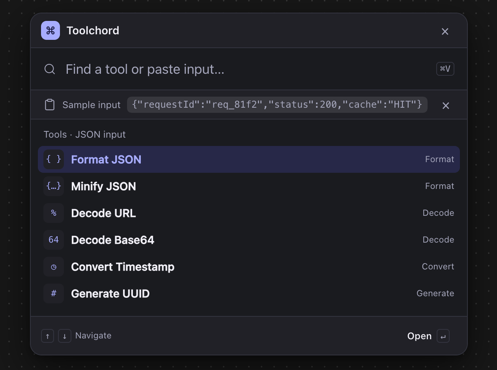
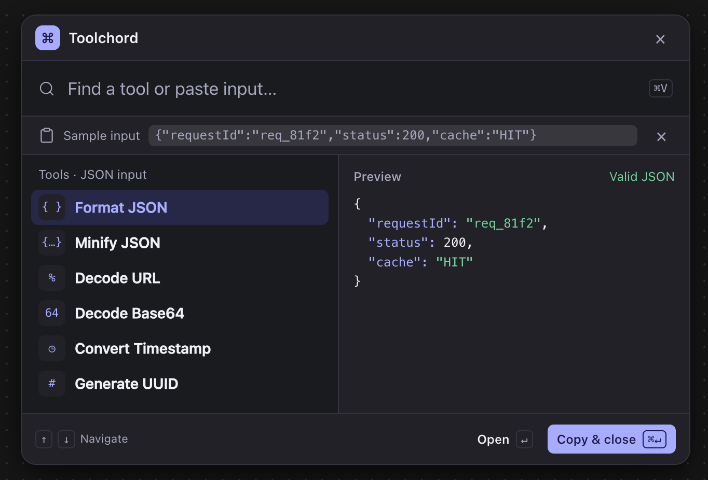
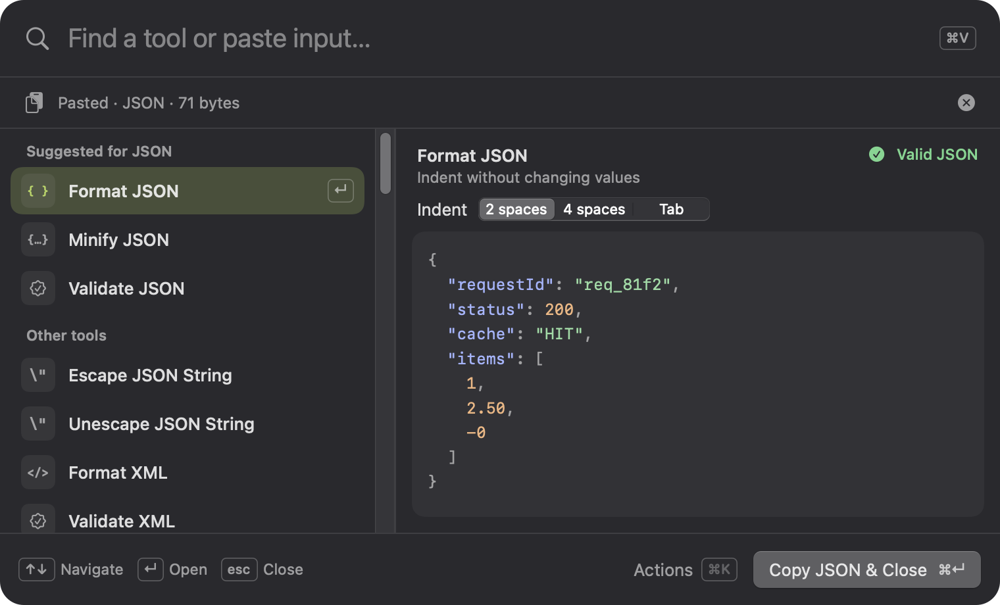
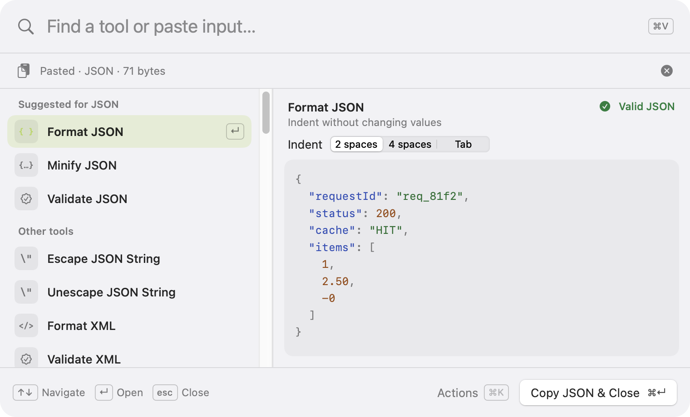
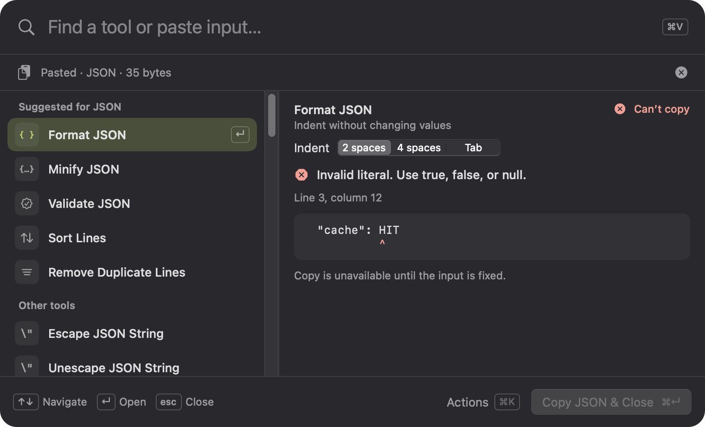
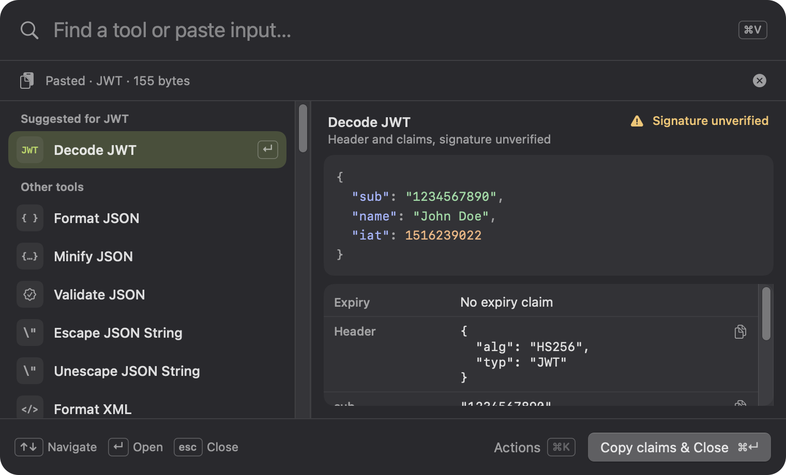
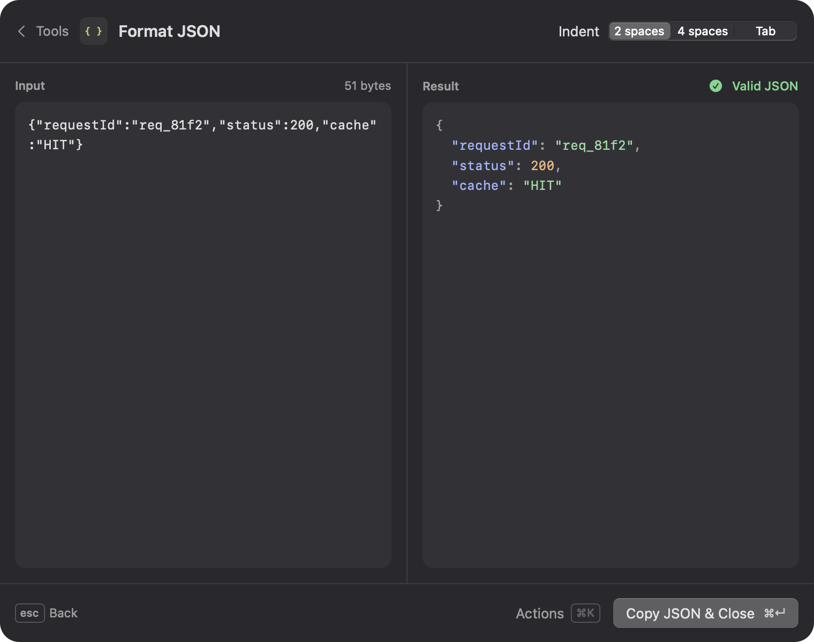
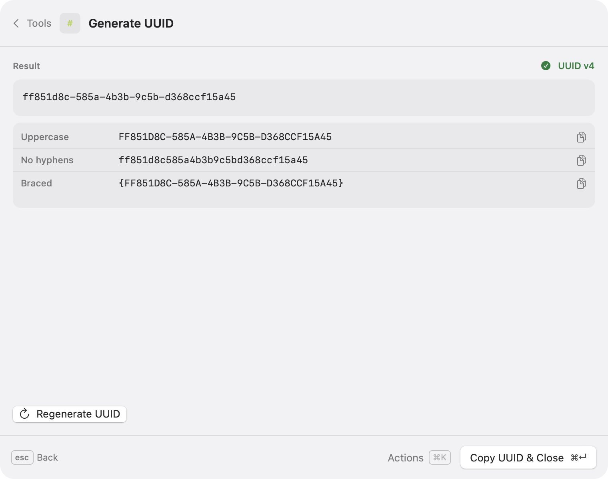

# Design review: mockups to native panel

Two mockups proposed a dark command palette: a list-only state after pasting JSON, and the same state with a preview and a **Copy & close** button. This review records what the native panel kept, changed, and dropped, and why. The [shortcut UX](shortcut-ux.md) is the reference for behavior.

| Proposed: list after paste | Proposed: list with preview |
| --- | --- |
|  |  |

| Implemented: dark | Implemented: light |
| --- | --- |
|  |  |

## Kept

- **Preview beside the list** (mockup 2). The core of the product: the selected command's live result is always visible, so the fast path needs no extra step.
- **Icon chips and verb-first titles.** Monospaced glyphs (`{ }`, `64`, `%`, `#`) or SF Symbols in small rounded chips, with titles such as "Format JSON".
- **⌘V hint in the search field**, now also a button that sends the same paste command.
- **A status beside the preview** ("Valid JSON") and **a prominent copy button with its key** (⌘↵).
- **Syntax-colored JSON**, extended to XML, with token colors that keep 4.5:1 contrast in both appearances.

## Changed

- **The pasted-input row shows metadata only.** Mockup 1 showed the pasted text in a chip. A paste is often a token or secret being hashed or decoded, so the row shows the source, detected type, and size (`Pasted · JSON · 71 bytes`) and the text appears only in the tool's editor.

- **Name the copy target.** "Copy & close" became **Copy JSON & Close**, **Copy claims & Close**, **Copy UTC time & Close**, and so on, so it is always clear what lands on the clipboard (inspectors have several candidates).
- **"Tools · JSON input" became "Suggested for JSON" plus "Other tools".** Mockup 1 listed Decode URL, Decode Base64, and Convert Timestamp under "JSON input", although none of them applies to JSON. Suggestions now come from detection, with every other tool still reachable below.
- **Category labels on the right were dropped.** "Format JSON — Format" repeats the verb, and the label takes the space the preview needs. The selected row shows ↵ instead, and the preview header shows the command's one-line summary.
- **Lavender accent became the system accent color.** The selection, focus rings, and Copy button follow the user's accent color like other Mac apps; lavender-to-indigo lives on in the app icon.
- **Flat dark surface became Liquid Glass** on macOS 26+ (vibrancy on 14–15), in light and dark appearance, falling back to opaque with Reduce Transparency.
- **Status gained a tone.** Success is green with a checkmark, warnings (such as **Signature unverified** for JWTs) are amber with a triangle, and errors are red with the offending line and a caret, so status never relies on color alone.
- **Options appear in the preview.** Indentation, units, alphabets, and modes sit under the preview header (and in the Actions menu), so the user rarely needs to open the tool.

## Dropped

- **The title bar row** ("⌘ Toolchord ✕"). It cost about 60 points of height and duplicated Escape; Spotlight and Raycast omit it too. The app's identity is in the menu bar icon and the app icon.
- **"Sample input" wording.** The real app only shows input the user pasted; there is no sample.

## Added beyond the mockups

| | |
| --- | --- |
|  |  |
|  |  |

- **Error context:** the message, location, and the offending line with a caret. Copy stays disabled until the input is fixed.
- **Expanded tool:** Return opens an editable input beside the full result, and the panel grows downward without moving its search area.
- **Fields with their own Copy buttons** for inspectors, generators, and conversions (URL parameters, JWT claims, timestamps, number bases, colors).
- **Actions menu** (⌘K) with every secondary action and the selected command's options, reachable from the keyboard.
- **Recent tools** at the top when nothing is attached, and a notice when the clipboard holds no text.

## Open questions for a visual pass

- The glass material can't be captured in offscreen snapshots; the images above use an opaque stand-in. Check contrast over busy wallpapers on macOS 26 and 27.
- Mockup 1's list-only state (no preview) could return as a compact mode for small displays; today the panel always reserves room for the preview and stacks the list above it below 640 points of width.
