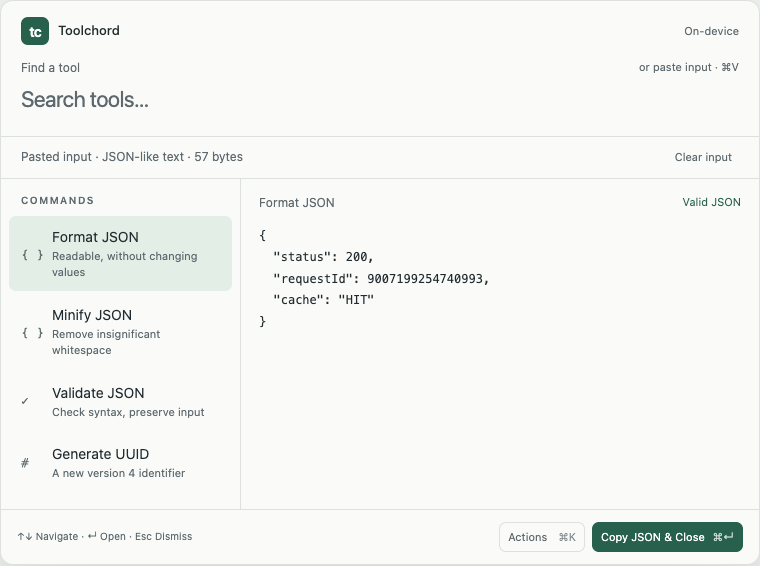

# Shortcut UX

Toolchord opens a single panel over the active app. Search finds a command, the preview shows its current result, and the expanded editor gives more room to inspect and edit. [Product plan](product-plan.md) · [Browser prototype](prototype/index.html)

## One panel, three levels of attention

**Find.** Open a compact panel with search focused and six or fewer visible command rows. Use verb-first commands, short aliases, and a footer with key hints. Place the panel on the display with the originating window when known, using the pointer’s display as a fallback. Keep the top edge and search field in place when expanding. Start around 680 points wide within the display’s visible frame.

**Inspect.** An explicit paste attaches a payload below search and opens a preview beside the command list. The attachment shows metadata such as `Pasted input · JSON · 42 bytes` or `Pasted input · Text · N bytes` when detection is uncertain. Actual content appears in the preview and expanded editor. Clear removes the attachment. When the pasted text resembles a command, **Use as search text** moves it into search.

**Edit.** Return opens the selected tool in the same panel, with input and output in columns. Focus the input editor for transforms and the first result control for a generator. Inspectors use labeled fields. Escape returns to search with the entire draft intact. On narrow displays, stack input and result. Let long editors scroll so the footer remains visible.

The fast path is **shortcut → paste → inspect → ⌘Return**. Return opens the editor when the user needs it. The footer names the visible result that Copy & Close will copy.

## Search and payload rules

- Typing edits the command query. An explicit paste while search is focused replaces the attached input and retains the query. Pasting elsewhere follows the focused control’s native behavior, including insertion at the caret in the editor.
- Edit → Paste and a labeled Paste action use the same native paste path. Read the clipboard only when the user pastes. If the clipboard does not contain text, keep the current payload and show a message.
- Rank exact names and aliases first, followed by prefixes, word matches in either order, and fuzzy matches. Explicit queries outrank detection. For example, `uuid` finds Generate UUID even when JSON is attached, and `json format` finds Format JSON.
- With an empty query, rank likely input actions first in a stable order. Keep a compatible selection that the user chose explicitly. Otherwise select the highest-ranked action when the payload changes. XML-like and JSON-like input can still suggest their formatters and validators when malformed. Validation supplies the error.
- A changed query selects its highest-ranked match. When replacing input under an explicit query, preserve the selection by command ID if it still matches. Preview completion leaves ranking and selection to the search and attachment state.
- When no commands match, show **No tools found** with **Clear search** and keep the attachment. Offer **Use as search text** for short, single-line input that matches a command or alias, even when the query is empty. This action moves the text into search and clears the attachment. Removing input disables commands that require it. An attached empty string remains a distinct input for tools that accept it.

## Keys and focus

| Context | Key | Result |
| --- | --- | --- |
| Anywhere outside Toolchord | Recorded hotkey | Open search, recording the source app. Propose `⌥⇧Space` only if registration succeeds. Menu-bar launch remains available. |
| Open panel | Recorded hotkey | Refocus the existing panel and retain its current draft and view. |
| Search | ↑ / ↓ | Select a command and evaluate its preview. Keep focus in search. |
| Search | Return | Open the selected tool. |
| Multiline input | Return / arrows / ⌘A | Native newline, caret movement, and select-all behavior. |
| Search preview or expanded tool | ⌘Return | Copy the current successful primary result shown in the panel and close. Disable copying while the result is pending or invalid. |
| Panel | ⌘K | Open Actions for copying without closing, clearing input, using plausible command text as search, or regenerating. Show the Actions button for pointer access. |
| Actions menu | Escape | Close only the menu and restore its trigger's focus. |
| Expanded tool | Escape | Back to command list, restore query focus and selected command. |
| Root list | Escape | Dismiss and clear the full session. |
| Any control | Tab / Shift-Tab | Follow visible control order. Arrow interception applies only in search/list navigation. |

Respect input-method composition. Return commits marked text and Escape cancels composition before either navigates the panel. Use native controls and VoiceOver labels for commands, result status, copy targets, and input controls. Announce completion or error once evaluation settles. Use text to convey selection, validity, and warnings, and honor Reduce Motion and Reduce Transparency. Verify native keyboard and VoiceOver behavior in the Mac spike.

On first launch, show the registered shortcut if available, offer a recorder, and explain that `⌘V` attaches the clipboard contents. If registration fails, show the failure and point to **Open Toolchord** in the menu bar. macOS uses `⌃⌘Space` for Character Viewer. [Apple shortcuts](https://support.apple.com/en-us/102650)

## Name the copy target

The footer names the primary result displayed for the current command and options. **Copy & Close** and **Copy without closing** copy that exact result. Normal `⌘C` copies selected text using native editor behavior. Individual field Copy buttons and **Copy without closing** preserve the session.

| Command | Primary result / footer |
| --- | --- |
| JSON format / minify | Transformed JSON text · **Copy JSON & Close** |
| JSON validate | Original JSON text after successful validation · **Copy input & Close** |
| Format XML | Formatted XML text · **Copy XML & Close** |
| Validate XML | Original XML text after a successful well-formedness check · **Copy input & Close** |
| Base64 encode / decode | Encoded text / decoded UTF-8 text · **Copy encoded text & Close** / **Copy decoded text & Close** |
| URL component encode / decode | Transformed component · **Copy component & Close** |
| Inspect URL query | Ordered JSON array of `{ "name": string, "value": string }` pairs, with repeated and empty pairs preserved · **Copy parameters & Close** |
| Inspect JWT | Decoded claims object as JSON · **Copy claims & Close**. The header and claims have individual Copy controls. Show **Signature unverified** beside the result. |
| Unix → ISO 8601 | UTC RFC 3339 text with milliseconds · **Copy UTC time & Close**. Show local time as a secondary value. |
| ISO 8601 → Unix | Number in the explicitly selected seconds/milliseconds unit · **Copy seconds & Close** / **Copy milliseconds & Close** |
| Generate UUID | Displayed lowercase UUID v4 · **Copy UUID & Close** |

Use a visible Seconds/Milliseconds selector for timestamp input and default to Seconds. Generate one UUID on first selection within the session and retain it through filtering and navigation until the user selects **Regenerate**.

## Draft lifetime and completion

A session draft includes the query, payload, edits, selected command, options, generated values, result, errors, and pending work. Back navigation and opening Actions preserve it. Root Escape, successful Copy & Close, switching to another app, screen lock, and app termination clear the draft and retire pending work. Clear input invalidates any result based on that input immediately. Store preferences such as hotkey, appearance, and indentation separately from the draft, which stays in memory.

Successful **Copy & Close** dismisses the panel. A failed write leaves it open with an actionable error. On deliberate completion or dismissal, request focus return to the app recorded at invocation when it is still available. macOS may decline the request. On external app switching, leave focus where the user moved it. [Apple activation behavior](https://developer.apple.com/documentation/appkit/nsrunningapplication/activate(from:options:))

## Prototype and review script

Open `docs/prototype/index.html` directly in a browser. The offline study covers JSON format, minify, and validate plus UUID generation. It simulates copy and dismissal. JSON formatting preserves lexical tokens, with illustrative error wording from the browser. Test global invocation, Mac paste permissions, focus return, full-screen Spaces, and VoiceOver in the native prototype.

1. Load the JSON sample, inspect the preview, and simulate Copy JSON & Close without opening the editor.
2. Reopen, type `pretty`, and press Return. Edit the JSON, then Escape; the query and edited payload survive.
3. Load invalid JSON. Copy must be disabled and the error must replace the previous result.
4. Load JSON, then search `guid`. UUID is selected despite the input; it remains stable until Regenerate.
5. Paste `json format` into search, choose Actions → Use as search text, and find Format JSON.
6. Reset to no input, open Generate UUID, then check keyboard navigation and the narrow stacked layout.

Raycast’s search and action panel and Alfred’s hotkey inputs informed the command and paste flows. [Raycast search](https://manual.raycast.com/search-bar) · [Raycast action panel](https://manual.raycast.com/action-panel) · [Alfred hotkey arguments](https://www.alfredapp.com/help/workflows/triggers/hotkey/)
