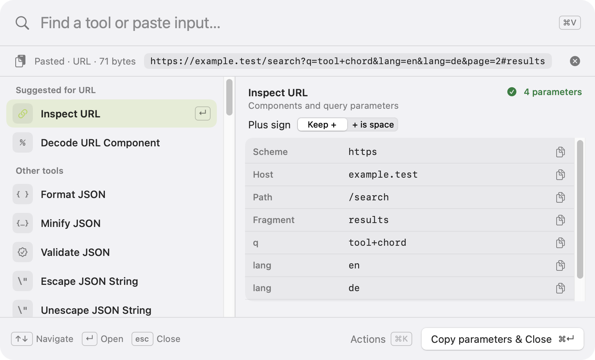

# Shortcut UX

Toolchord opens a single panel over the active app. Search finds a command, the preview shows its current result, and the expanded tool gives more room to inspect and edit. [Product plan](product-plan.md) · [Design review](design-review.md)

## One panel, three levels of attention

**Find.** The panel opens with search focused and a list of commands. Titles are verb-first ("Format JSON", "Convert to snake_case"), and aliases cover common words such as `pretty print`, `epoch`, `GUID`, `slugify`, and `sha256`. Footer hints show the keys that work right now.

**Inspect.** ⌘V attaches the clipboard below search and shows `Pasted · JSON · 71 bytes` with a one-line excerpt. Commands that fit the input move to **Suggested for JSON**, and the preview beside the list shows the selected command's live result, its options, and a status. Clear (⇧⌘⌫ or the ✕ button) removes the attachment. When the pasted text names a command, **Use Input as Search Text** moves it into search.

**Edit.** Return opens the selected command in the same panel: input and result side by side for transforms, labeled fields with Copy buttons for inspectors, and the value with a Regenerate button for generators. Escape returns to search with the whole draft intact.

The fast path is **shortcut → ⌘V → read the preview → ⌘↵**. The footer always names what ⌘↵ will copy.

## Search and payload rules

- Typing edits the query. ⌘V while search has focus replaces the attached input and keeps the query. ⌘V in the input editor pastes at the caret.
- Edit › Paste, ⌘V, and the ⌘V button use the same paste command, and the clipboard is read only then. If it holds no text, the current input stays and a notice says so.
- Ranking: exact title or alias, then prefix, then all words in any order (including the tool family, so `json` lists every JSON command), then fuzzy. Explicit queries outrank detection: `uuid` finds Generate UUID even with JSON attached, and `json format` finds Format JSON.
- With no query, suggestions for the input come first by relevance, then every other tool in a stable order. Malformed JSON-like and XML-like input still suggests their formatters, so validation can show the error. With nothing attached, up to four recently used tools come first.
- A changed query selects its best match. New input keeps a selection the user chose if it still fits the input.
- No matches shows **No tools found** with **Clear search**, keeping the attachment. Commands that need input show "Paste input to preview" until there is some; an attached empty string is real input.

## Keys and focus

| Context | Key | Result |
| --- | --- | --- |
| Any app | Recorded shortcut (default ⌥⇧Space) | Open search, remembering the app it opened over. If the default can't be registered, ⌃⌥⌘Space is used instead; the menu bar item always works. |
| Open panel | Recorded shortcut | Refocus the panel, keeping its draft and view. |
| Search | ↑ / ↓, Page Up / Page Down, ⌘↑ / ⌘↓ | Move the selection; the preview follows and focus stays in search. |
| Search | Return | Open the selected tool. |
| Input editor | Return, arrows, ⌘A, ⌘Z, ⌘F | Native newline, caret movement, selection, undo, and find. Tab moves focus; ⌥Tab inserts a tab. |
| Search or tool | ⌘↵ | Copy the current successful result and close. Disabled while pending or invalid. |
| Search or tool | ⇧⌘↵ | Copy without closing. |
| Panel | ⌘K | Actions menu (also the **Actions** button): copy without closing, open or back, paste, use input as search text, clear input, regenerate, the selected command's options, Settings, Close. |
| Panel | ⌘R / ⇧⌘⌫ / ⌘, / ⌘W | Regenerate / clear input / Settings / close. |
| Actions menu | Escape | Close only the menu. |
| Expanded tool | Escape | Back to search with the query and selection restored. |
| Search | Escape | Dismiss and clear the whole session. |

Input methods get Return and Escape first while composing, and ⌘↵ is ignored until composition ends. Controls carry VoiceOver labels, list rows report selection, and results and errors are announced once evaluation settles. Selection, validity, and warnings are conveyed with text and symbols, not color alone.

On first launch, a welcome window shows the shortcut and whether it's active, offers a recorder and one-click choices (⌥⇧Space, ⌃⌘Space, ⌃⌥⌘Space), and explains ⌘V and ⌘↵. ⌃⌘Space is offered with a note that it takes over Emoji & Symbols in every app.

## Name the copy target

| Command | Primary result / footer |
| --- | --- |
| Format JSON, Minify JSON | Transformed JSON · **Copy JSON & Close** |
| Validate JSON, Validate XML | The original input after a successful check · **Copy input & Close** |
| Escape / Unescape JSON String | The string literal / the decoded text · **Copy string & Close** / **Copy text & Close** |
| Format XML | Formatted XML · **Copy XML & Close** |
| Encode / Decode Base64 and Base64URL | Encoded text / decoded UTF-8 text · **Copy encoded text & Close** / **Copy decoded text & Close** |
| Encode / Decode URL Component | The transformed component · **Copy component & Close** |
| Inspect URL | Ordered JSON array of `{"name", "value"}` pairs · **Copy parameters & Close**; each component and pair has its own Copy button |
| Decode JWT | Claims JSON · **Copy claims & Close**, with **Signature unverified** shown as a warning; the header and each claim have Copy buttons |
| Convert Unix Time | UTC RFC 3339 with milliseconds · **Copy UTC time & Close**; local time, Unix values, and relative time as fields |
| Convert Date to Unix Time | A number in the selected unit · **Copy seconds & Close** / **Copy milliseconds & Close** |
| Show Current Time | Seconds, milliseconds, or UTC text, by option |
| Generate UUID / UUID v7 / ULID | The value shown · **Copy UUID & Close** / **Copy ULID & Close** |
| Generate Random String / Lorem Ipsum | **Copy string & Close** / **Copy text & Close** |
| Hash with SHA-256 (and others) | Lowercase hex digest · **Copy hash & Close** |
| Case and slug conversions, Sort / Deduplicate / Reverse Lines, Unescape HTML, Decode Hex to Text | **Copy text & Close** or **Copy lines & Close** |
| Escape HTML, Encode Text as Hex | **Copy HTML & Close** / **Copy hex & Close** |
| Convert to Decimal / Hex / Binary / Octal | **Copy decimal & Close**, and so on; all four bases as fields |
| Convert Color to Hex / RGB / HSL | **Copy hex color & Close**, and so on; swatch and all three notations as fields |
| Count Characters | The character count · **Copy character count & Close**; words, lines, and byte counts as fields |

Normal ⌘C copies selected text in any editor or result. Field Copy buttons and **Copy without closing** keep the session open and confirm with a short notice.

## Draft lifetime and completion

The draft — query, payload, edits, selected command, options, generated values, result, errors, and pending work — survives Back and the Actions menu. Root Escape, Copy & Close, switching to another app, screen lock, sleep, user switching, and quitting clear it and retire pending work. Clear Input invalidates any result based on that input immediately. Preferences (shortcut, indentation, menu bar icon, recent tools) are stored separately; the draft stays in memory.

Copy & Close dismisses only after the clipboard write succeeds; a failed write keeps the panel open with an error. Because the panel never activates Toolchord, the app it opened over keeps focus and regains the keyboard as soon as the panel closes. If Toolchord did become active (for example through Settings), it asks the original app to reactivate. On an app switch, focus stays where the user moved it.

## Design history

The browser study in [`prototype/`](prototype/index.html) explored this interaction before the native app existed; open `docs/prototype/index.html` in a browser to try it. It covers JSON and UUID only and simulates the clipboard. The native panel replaces it as the reference; [design review](design-review.md) compares the two and the proposed mockups.
